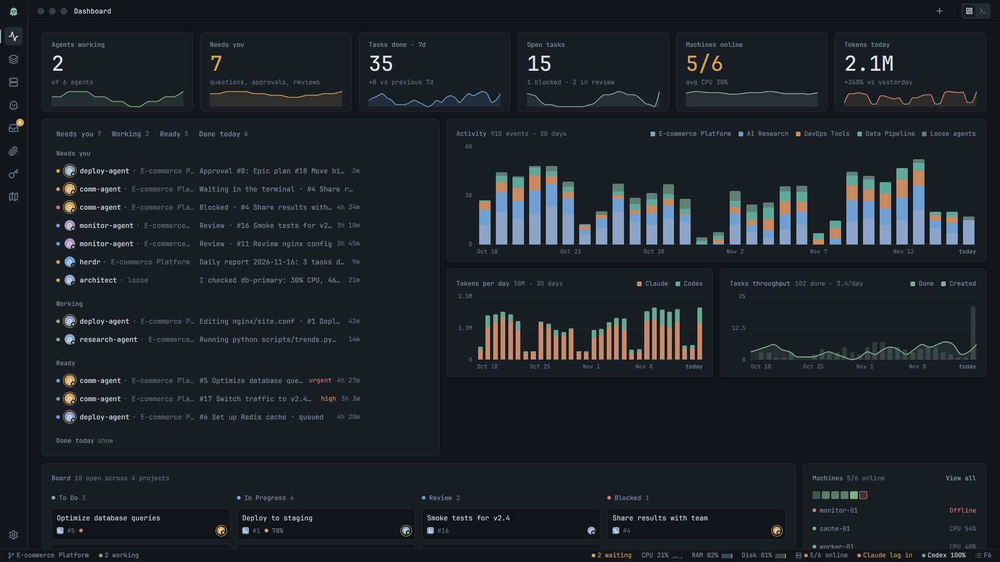
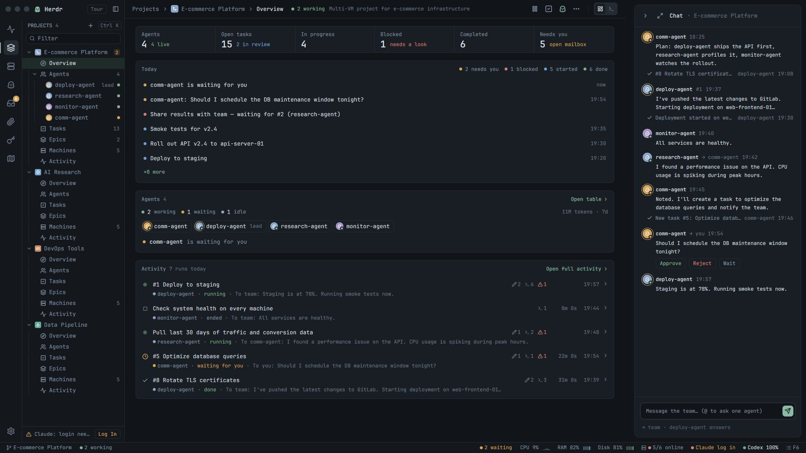
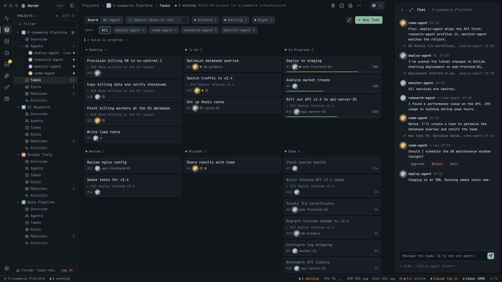
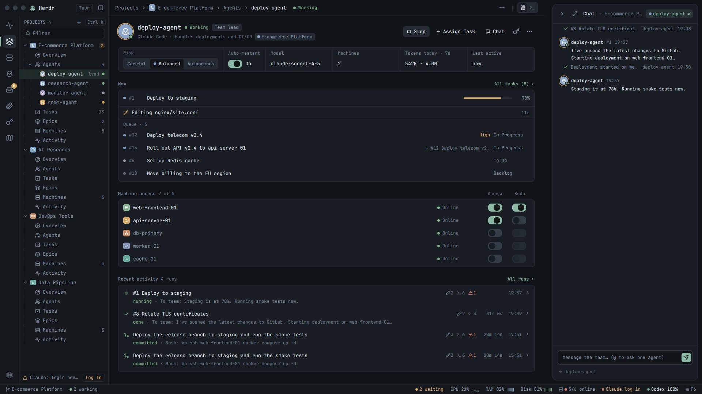
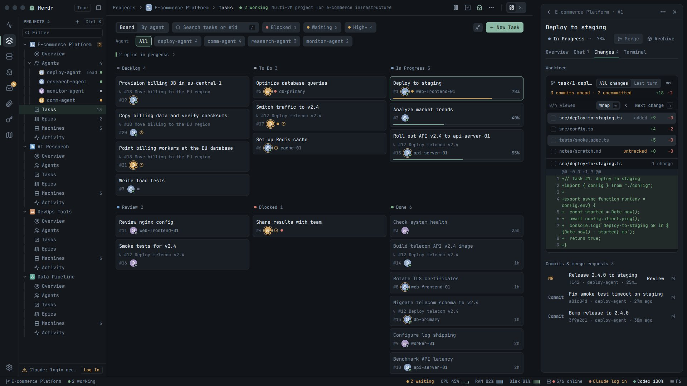
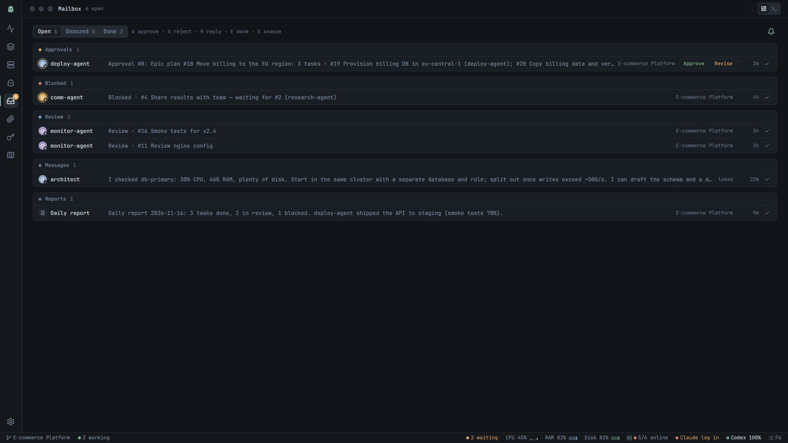
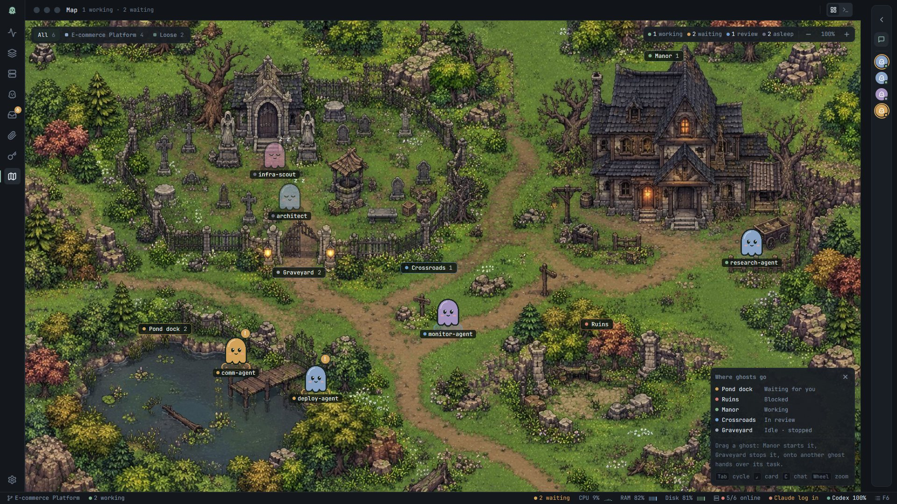

# Hyper View — an agent workspace layout for Herdr

A calm, keyboard‑first workspace for running **teams of AI coding agents** (Claude Code and Codex) across projects and many virtual machines — built as a layout + mod for the [Herdr](https://herdr.dev) desktop app.

Projects, agents, tasks, machines, secrets and a shared team chat live in one IDE‑style window. Agents coordinate through a small CLI (`hp`): they pick tasks from a board, talk to each other, reach your machines over SSH and use your Git tokens — **without ever seeing a password or token**.

> **Windows only (for now).** Credentials are stored in the **Windows Credential Manager**, and the `hp` CLI is a Windows PowerShell 5.1 script. macOS/Linux support would need a different secret store.



## Highlights

- **Dashboard** — what needs you first (approvals, questions, blocked tasks), who is working on what, 30‑day activity, tokens per day, task throughput, a cross‑project mini board and machine health.
- **Projects** — overview, agents, a task board (Backlog → To Do → In Progress → Review → Blocked → Done), **epics** that the lead agent breaks down into tasks for your approval, machines and a run‑based activity view.
- **Agents** — Claude Code or Codex, single or as ready‑made teams, a lead per project, per‑agent **risk level** (Careful / Balanced / Autonomous), machine and sudo access, auto‑restart, live “what is it doing now”.
- **Team chat** per project — one lead answers team messages, `@mentions` reach one agent, approve / reject agent questions with one key.
- **Task workspace** — description, chat, changes (worktree diff with inline comments sent back to the agent), terminal, merge & archive; evidence required for review/done; automatic cross‑model review (Claude ↔ Codex).
- **Machines** — add or import many VMs, live CPU / RAM / disk, locks while an agent deploys, a VS Code‑like **Neovim editor** that edits the machine's files over SSH (nothing installed on the VM).
- **Tokens & Access** — GitLab, GitHub, Bitbucket, registries, cloud keys, databases, SSH keys… shared per project; agents use them through `hp git`, `hp api`, `hp run --with` and never read them.
- **Mailbox** — every approval, question, blocked task and daily report in one place, with snooze.
- **Agent map** — a little pixel‑art village where your agents walk around as ghosts: their location shows what they're doing; click one to chat, assign a task or open its board.
- **Keyboard‑first** — `Ctrl+K` command palette with per‑item actions (`→`), `F6` focus zones, tree navigation, `Ctrl+/` cheat sheet.
- **Guided tour** — click **Tour** next to the logo; it loads demo data, nothing real changes.

| | |
|---|---|
|  |  |
|  |  |
|  |  |

## Requirements

- Windows 10/11 with **Windows PowerShell 5.1** (built in)
- [Herdr](https://herdr.dev) desktop app
- **Claude Code** and/or **Codex CLI** for the agents
- **OpenSSH client** (built into Windows) for machines
- Optional for the editor: `winget install Neovim.Neovim Git.Git BurntSushi.ripgrep.MSVC`

## Install

```powershell
git clone https://github.com/<you>/hyper-view.git
cd hyper-view
powershell -ExecutionPolicy Bypass -File .\install.ps1
```

The script copies `layouts/`, `themes/` and `mods/hyper-view/` into `%USERPROFILE%\.config\herdr-app\` and merges the keyboard shortcuts from `hyper-view/keys.json` into your `keys.json` (a backup is kept as `keys.json.bak`).

Then restart Herdr and pick the layout **hyper-view** (Settings → Layout, or `Ctrl+Shift+L`). On first start the mod creates `~/.herdr` (projects, database, the `hp` command) by itself.

<details>
<summary>Manual install</summary>

1. From the `hyper-view` folder copy `layouts\hyper-view.json`, `themes\hyper-view-*.json` and the whole `mods\hyper-view\` folder into `%USERPROFILE%\.config\herdr-app\` (same sub‑folders).
2. Open `%USERPROFILE%\.config\herdr-app\keys.json` and add the `"layout:hyper-view"` section from `hyper-view\keys.json`; add its four `"terminal"` lines to your own `"terminal"` section.
3. Restart Herdr and select the **hyper-view** layout.
</details>

## Getting started

1. Click **Tour** for a 2‑minute walkthrough on demo data.
2. Add a machine (`+` in Machines, or import a CSV / JSON / `~/.ssh/config` list) and install your SSH key on it.
3. Add tokens in **Tokens & Access** and share them with a project.
4. Create a project, add an agent or a team, write a task or an epic — and watch the board.

## Keyboard

| Area | Keys |
|---|---|
| Everywhere | `Ctrl+K` palette (`→` actions) · `Ctrl+/` shortcuts · `F6` / `Shift+F6` focus zones · `Ctrl+J` next agent waiting for you |
| Modes | `Ctrl+Shift+D` Dashboard · `M` Mailbox · `A` Tokens · `E` Projects · `H` Machines · `G` Agents · `Ctrl+Shift+B` explorer |
| Project | `Alt+1–6` Overview / Agents / Tasks / Epics / Machines / Activity · `Ctrl+Shift+↑/↓` previous / next project |
| Lists & tree | `↑↓` / `j k` move · `Enter` open · `→` expand or actions · `←` collapse · `/` filter · `Esc` back |
| Chat | `@` pick an agent (`↑↓`, `Tab`) · on a question: `A` approve, `R` reject, `W` wait |
| Mailbox | `A` approve · `X` reject · `R` reply · `E` done · `S` snooze |

## How agents work

Each project has a generated `AGENTS.md` — the agents' contract: operating reality, sacred boundaries per risk level, named principles, a working loop, multi‑agent Git hygiene, and the `hp` reference (tasks, chat, memory, locks, secrets, approvals, epics). Agents run locally in Herdr terminals with the project folder as working directory and reach machines only through `hp ssh` / `hp sudo`. A supervisor restarts agents that still have work, nudges idle ones with ready tasks, and keeps a handoff note so a restarted agent picks up where it left off.

## Privacy & security

- No secrets live in this repository or in your project files: passwords and tokens go to the **Windows Credential Manager**; only their names and metadata are stored in `~/.herdr`.
- Agents receive credentials only for the duration of a single command, and secret values are masked in output.
- Risky commands (pushing to `main`, restarting services, destructive database or Kubernetes operations) require your approval in the Mailbox unless you mark an agent **Autonomous**.

## Repository layout

```
hyper-view/                 the layout folder (as listed on herdr.dev/layouts)
  layouts/hyper-view.json   Herdr layout
  themes/                   light + dark themes
  mods/hyper-view/          the mod (UI views, hp.ps1 CLI, supervisor, Neovim config, icons)
  keys.json                 keyboard shortcuts to merge into your keys.json
  RECIPE.md                 the brief another agent can rebuild the layout from
  preview.png               gallery screenshot
install.ps1                 installer
docs/screenshots/           README images
```

## Disclaimer

This is a personal, experimental project, provided **as is**, with **no warranty of any kind** and no guarantee that it works, keeps working with future Herdr, Claude Code or Codex versions, or is fit for any purpose. AI agents run commands, change code and can act on your machines and accounts with the permissions you give them — review their risk levels, machine/sudo access and shared tokens, and use it at your own risk. The author is not liable for any damage, data loss, costs or other consequences of using it.

## License

MIT — see [LICENSE](LICENSE). You may use, copy, modify, merge, publish, distribute, sublicense and sell it, provided the copyright notice and license text are kept; it comes without any warranty. Made by Marcel S.
