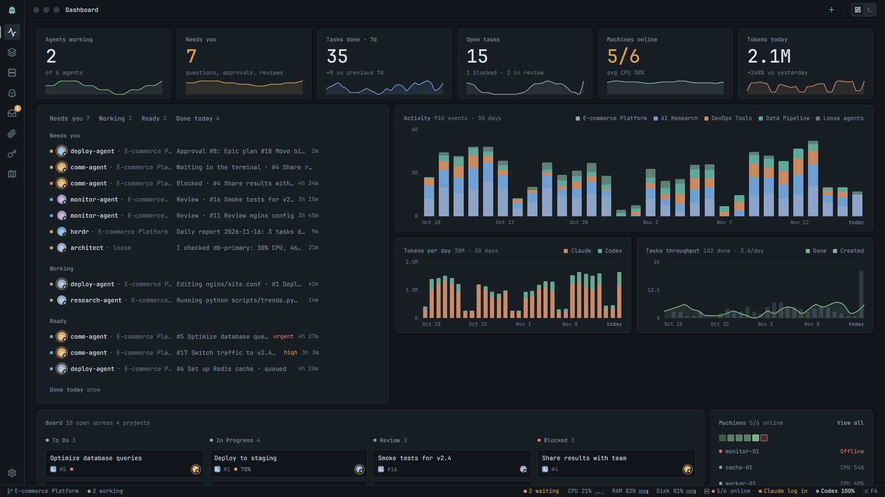

# Hyper View

A calm, IDE-style workspace for running teams of AI coding agents (Claude Code, Codex) across projects and many virtual machines. A thin icon bar on the left switches between modes; next to it an explorer tree lists projects, machines or agents; the center shows a "Needs you" dashboard, a project's task board, an agent page, a machine with a VS Code-like Neovim editor, a mailbox of approvals, secrets, or a pixel-art village where the agents walk around as ghosts; a collapsible chat panel on the right holds the project's team chat; a 24px status bar sits at the bottom. Agents coordinate through a bundled CLI (`hp`) and never see passwords or tokens. Windows only (Windows Credential Manager + Windows PowerShell 5.1).

## What you see

Font JetBrains Mono everywhere (UI 13px base, layout `font_size` 13). Two themes, `hyper-view-dark` / `hyper-view-light`:

| token | dark | light |
|---|---|---|
| canvas | `#111418` | `#F5F6F8` |
| chrome (side bars) | `#14181d` | `#EEF0F3` |
| surface (cards) | `#191E24` | `#ffffff` |
| raised / border | `#242B33` | `#F5F6F8` / `#E8EBEF` |
| foreground / muted / dim | `#DCE3EB` / `#8291A3` / `#6b7787` | `#303640` / `#64748B` / `#848e9c` |
| accent (sage) | `#8cb8a6` | `#3f7f6f` |

Status colors: working `#7fb08a`, waiting `#d4a35a`, blocked/error `#d57c74`, info `#6f9fd0`. Agent and project colors come from a 12-color palette hashed by name. Text sizes only 11 / 12 / 13 / 15 / 20; rows 24–32px; radius 4 / 6 / 8 / 10. No gradients, no shadows on flat elements, status shown as a 6px dot + text.

Left to right, top to bottom:

1. **Window lights row** (40px, draggable): traffic lights, ghost logo, "Herdr", a small **Tour** button, sidebar toggle.
2. **Activity bar** (48px icon rail, always visible): Dashboard, Projects, Machines, Agents, Mailbox (amber count badge), Clipboard, Tokens & Access, Agent map; Settings at the bottom. The active mode has a 2px accent bar on its left edge.
3. **Explorer** (220px, part of the 268px sidebar column; hidden in full-width modes): a filter box and a tree for the current mode.
   - Projects → project (colored tile, status dot) → Overview / Agents (its agents) / Tasks / Epics / Machines / Activity, with dim counts.
   - Machines → "All machines" + each machine (CPU%, lock icon) → Overview / Editor / Access.
   - Agents → grouped by project (tile + full project name + count), loose agents last; the lead is marked "lead".
   - A footer line appears only when a Claude/Codex limit is low or a login is needed.
4. **Header** (40px): breadcrumb (e.g. Projects › E-commerce Platform › Tasks), a status pill, icon actions, Workspace/Terminals toggle.
5. **Center** — a stack of three: the mod view, the Herdr terminal tabs, and the machine editor column.
   - **Dashboard** (full width): six stat tiles with sparklines (agents working, needs you, tasks done 7d, open tasks, machines online, tokens today); a "Needs you" list (approvals, questions, blocked, review; hover actions with key hints); a 30-day activity chart stacked by project, tokens per day (Claude/Codex), task throughput; a cross-project mini board (4 cards per column, "+N more"); machine heat grid and limits.
   - **Project Overview**: one stat strip, "Today" list, agents summary, recent activity runs.
   - **Agents**: sortable table (name, status, engine/model, risk, current task, last active, tokens 7d, machines), multi-select bulk actions.
   - **Tasks**: toolbar (Board / By agent, search, Blocked / Waiting / High+ quick filters, agent chips or a dropdown when >6 agents, New Task); board with Backlog, To Do, In Progress, Review, Blocked, Done — six columns in one row when each gets ≥200px, otherwise a 3×2 grid; compact cards (title up to 2 lines, `#id`, 18px agent avatar, priority dot, machine, thin progress bar with 4px gap, "↳ #N epic" line); 6 cards per column then "+N more". A one-line link "N epics in progress ›".
   - **Epics**: one row per epic — 3px green left bar, "EPIC", `#id title`, lead avatar, plan state (needs plan / awaiting approval / in progress / done), progress n/m; expands to its tasks.
   - **Agent page** (project and loose agents alike): header with actions (Start/Stop, Assign task, Chat, Project access, …), one property strip (Risk Careful/Balanced/Autonomous, Auto-restart, model, machines, tokens today·7d, last active), then full-width sections Now, Machine access, Recent activity (runs).
   - **Activity**: runs (one row per session/task: outcome, edits/commands/errors counts, duration, last message), expandable to key steps; a Steps mode with a virtual list.
   - **Machines overview**: heat grid (one square per VM by CPU), search, filters (Online/Offline/High CPU/Locked), grouping, sortable table, 24 per page.
   - **Machine**: Overview (stat strip, info), **Editor** (40px path bar with clickable breadcrumb, branch, Files/Search/Commands/Terminal buttons, then Neovim full height, optional SSH shell 240px below), Access (sudo switch, projects, agents).
   - **Mailbox**: groups Approvals → Questions → Blocked → Review → Messages → Reports; Open / Snoozed / Done.
   - **Tokens & Access**: list of secrets (service icon, type, host, shared projects, expiry), a 3-step "Add Secret" wizard (service tile → token type card → fields).
   - **Clipboard**: saved prompts/notes with Copy / Edit / Delete and pin.
   - **Agent map** (full width): the pixel-art village (`icons/agent-map.jpg`) scaled to fit; ghosts with name labels walking slowly inside zones.
6. **Chat panel** (380px, collapsible to 0, full-width toggle): team chat of the current project with 20px avatars; agent questions get Approve / Reject / Wait; a composer with "@" agent completion and a dim line "→ team · <lead> answers". Hidden in Dashboard / Mailbox / Tokens / Clipboard / Machines / Map modes. A task opened anywhere replaces the chat with a task workspace (tabs Overview / Chat / Changes / Terminal, Merge / Archive).
7. **Status bar** (24px): project, branch, agents working | waiting count, CPU / RAM / disk with mini bars, machines online, Claude / Codex limits, F6 hint.

A start-up splash (ghost "Codie" pops in, smiles and waves, "Hi <user>, I'm Codie / Welcome to Hyper-view Herdr by Marcel S", then dissolves) and a 20-step guided tour with a spotlight and the same ghost.

## How it behaves

- **Agent statuses** (from Herdr's agent detection): working = green dot (and a green pulsing ring on the map, ghost in the manor), blocked/waiting for you = amber dot + amber ring on the avatar everywhere + "!" bubble on the map dock, done = blue, idle = dim, stopped = translucent ("z z" in the graveyard). A project row shows an amber count instead of its dot when an agent waits.
- **Modes**: clicking an activity-bar icon switches mode and shows/hides the explorer and chat (Dashboard, Mailbox, Tokens, Clipboard, Map: full width; Projects: first/last project's Overview + chat; Machines: machine, no chat; Agents: agent page + chat). Clicking the active icon toggles the explorer. Manual changes are remembered per mode.
- **Keyboard**: Ctrl+K palette (fuzzy; → / Tab shows an item's actions; dangerous actions ask for a second Enter); Ctrl+/ shortcut sheet; F6 / Shift+F6 cycle focus zones (activity bar → explorer → header → view → chat → status bar) with a 1px accent focus ring; Ctrl+J next waiting agent; Ctrl+Shift+D/M/A/E/H/G modes; Ctrl+Shift+B explorer; Alt+1–6 project sub-views; Ctrl+Shift+↑/↓ previous/next project; explorer = WAI-ARIA tree keys (↑↓ → ← Enter Space, type-ahead, `.` actions, `/` filter); lists j/k, Enter, → actions; chat A/R/W on questions; mailbox A/X/R/E/S; map Tab/arrows, c chat, t task, o open. Focus returns to the previous zone when any dialog or popup closes.
- **Hovers**: rows highlight, hover actions show key hints, times show the exact time, the map shows name · project · status · task.
- **Motion** (native GPUI transition/loop only, never per-frame JS): ghosts glide to a random point in their zone every 3–6s (2–4s ease-in-out), panels slide (~180ms), the tour spotlight glides (420ms), the splash springs.
- **Agents' side** (`hp`, generated `AGENTS.md` per project): tasks (ready / claim with lease / start / progress / review with evidence / done / block / handoff / depends / link commits and MRs), epics (lead plans tasks, human approves in Mailbox), team chat (one lead answers team messages, @mentions, threads, acks), memory (recall / remember / decide / reflect), machine locks, file reservations, approvals for risky commands by risk level, secrets via `hp git` / `hp api` / `hp run --with` with values masked. A supervisor restarts agents that still have work, nudges idle ones, sends owners a coalesced message when the human changes priority/column/assignee, and writes a daily report to the Mailbox.

## Built from

- **Layout** `layouts/hyper-view.json`: column `root` → row `mp-top` [ column `mp-sidebar-col` (268px, min 48, max 440, chrome) [ block `mp-lights` (40px, window_drag, role lights), block `mp-sidebar` (role sidebar) ], row `mp-body` (gap 10) [ column `mp-main-col` (min 0) [ block `mp-header` (40px, window_drag, role header), stack `mp-center` (active `mp-view`) [ block `mp-view` (role view), column `mp-terms` (padding 0 10) [ block `mp-tabs` (38px, role tabs), block `mp-main` (`tab: "active"`, pane header mod `pane`) ], column `mp-vmterm` (padding 12 24, children filled at runtime) ] ], column `mp-chat-col` (380px, min 0, max 4000, padding 10) [ block `mp-chat` (role chat) ] ] ], block `mp-status` (24px, role status). Theme pair `hyper-view-light`/`hyper-view-dark`, font JetBrains Mono, `titlebar: "none"`, `traffic_lights: [14, 18]`.
- **One mod** `mods/hyper-view/` (`main.js` default-exports a View that picks a role from `props.role`): lights, header, tabs, sidebar, view, chat, status, editor-bar, vmterm-empty, form, palette, pmenu, splash, tour. Main files: `sidebar.js`, `toolbar.js`, `workspace.js` (router + project views), `dashboard.js`, `agentsview.js`, `projectactivity.js`, `activityview.js`, `activity.js` (session-log parser), `taskpanel.js`, `review.js`, `chat.js`, `mailbox.js`, `secrets.js`, `secretwizard.js` + `secretkinds.js`, `vmview.js`, `editor.js` + `nvim/` (Neovim config, `-u nvim/init.lua`), `mapview.js`, `palette.js` + `actions.js` + `shortcuts.js`, `form.js`, `charts.js` (native `paint_path` lines, div bars), `tokens.js` (design tokens), `ide.js`, `lib.js`, `supervisor.js`, `notifier.js`, `attention.js`, `maintenance.js`, `dailyreport.js`, `splash.js`, `tour.js`, `demo.js` (in-memory demo data; Tour turns it on). Shipped mod used: `pane` (terminal pane header).
- **CLI** `mods/hyper-view/hp.ps1` (Windows PowerShell 5.1, UTF-8 with BOM) installed as `~/.herdr/bin/hp.cmd`; data in `~/.herdr` (projects/<slug>/{project.json, agents.json, tasks.json, events.jsonl, AGENTS.md, CLAUDE.md}, herdr.db via winsqlite3, machines.json, secrets.json metadata). Secrets and VM passwords in Windows Credential Manager (`herdr:secret:<name>`, `herdr:vm:<vm>:ssh|sudo`). SSH aliases `herdr-<vm>` in `~/.ssh/config`. `activity.ps1` reads Claude Code (`~/.claude/projects`) and Codex (`~/.codex/sessions`) logs incrementally.
- **herdr functions**: `shared`/`setShared`, `run` (`layout.select`, `layout.resize`, `layout.hide`/`show`, `layout.set` via `herdr-app do`, `tab.new`, `space.new`, `agent.focus`, `pane.focus`, `terminal.kill`, `app.settings`, `app.theme`), `openOverlay`/`closeOverlay`, `exec`, `hc` (background terminals for ssh, Neovim, logins), `agents`, `spaces`, `panes`, `layout`, `theme`, `settings`, `keys`, `nextCommand`, `notify`, `readTextFile`/`writeTextFile`, `watchFolder`.
- **Programs run**: `powershell.exe` (hp, activity, stats), `ssh`, `herdr-app`, `nvim`, `git`, `rg` (optional), `winget` (on request: Neovim/ripgrep), `explorer.exe` (open folders/URLs), `claude`, `codex`. The mod reaches the network only through these (git, provider APIs via hp, SSH to your machines, Claude/Codex usage endpoints).
- **Keys** `keys.json` section `layout:hyper-view` (Ctrl+K, F1, Ctrl+J, Alt+1–6, Ctrl+Tab, Ctrl+Shift+↑/↓/D/M/A/E/H/G/B, Ctrl+`, F6, Ctrl+F, Ctrl+/) plus `terminal` pass-through for Ctrl+K/J/F// so shells keep them.
- **Art**: icons are original line SVGs in `icons/`; ghost sprites `icons/ghosts/<color>-{awake,sleep}.svg` (12 colors); splash layers `icons/splash/`; the village map `icons/agent-map.jpg` (AI-generated pixel art).

## Watch out

- Windows only: Credential Manager, PowerShell 5.1 (`hp.ps1` must stay UTF-8 with BOM; same-line statements need `;`), `where.exe`, `explorer.exe`.
- Herdr drops a layout block whose terminal ended — the editor column (`mp-vmterm`) is rebuilt with `herdr-app do layout.set` each time; `run("layout.set")` from a mod did not apply.
- Layout sizes are unzoomed px while measured sizes are zoomed (`settings().zoom`); full-width chat and the tour divide by zoom. A share-1 overlay is drawn scaled by zoom, so the tour paints its dim layer over root size ÷ zoom.
- Never create `InputState`/focus handles or call `focus()` during render (throws); create in `init` or handlers, focus via `cx.timer.after(1, …)`.
- Keep timers per view and bounded: a folder watch on `~/.herdr` must ignore agents' worktrees, charts must not write a new image per tick (the image cache grows until "out of memory").
- Many hot reloads in a long session can exhaust the mod runtime (`Null "null"`); a full Herdr restart fixes it.
- Herdr takes some keys before Neovim (Ctrl+Shift+P/F, F2, Alt+arrows, Ctrl+Tab); the editor maps alternatives (Ctrl+Alt+P/F/R, Ctrl+Alt+←/→). Ctrl+Backspace arrives as Ctrl+W, so Ctrl+W deletes a word and Ctrl+F4 closes a file.
- Agent map caps drawn ghosts at 60 ("+N"); tasks show 6 cards per column; machines 24 per page.
- Demo data is in-memory only; the dev bridge in `devbridge.js` is a no-op in this package.

## Done when

- `herdr-app check mods/hyper-view` passes and the layout switches without "This view could not be re-rendered" banners.
- First start creates `~/.herdr` and `hp help` works in a terminal.
- Clicking each activity-bar icon moves the accent bar to it and shows/hides explorer and chat as described; Ctrl+K opens the palette and → shows an item's actions.
- With the Tour (demo data): the dashboard shows 6 tiles and charts, the task board shows six columns or a 3×2 grid with nothing clipped, Epics lists two epics, an agent page shows the risk strip, the Mailbox shows an epic plan with Approve/Revise, the map shows ghosts moving between zones and clicking one opens its card.
- Adding a machine stores its password in Credential Manager, `hp ssh <vm> --as <agent> "uptime"` runs, and the Editor tab opens Neovim on the machine's home over SSH.
- Creating a project and an agent writes `AGENTS.md`, starts the agent in a Herdr tab, and a task moved by the agent appears on the board live.
